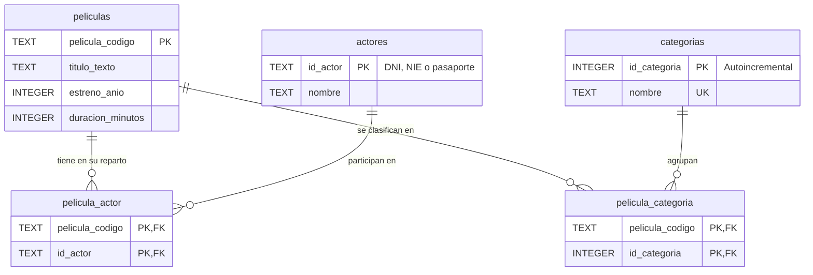
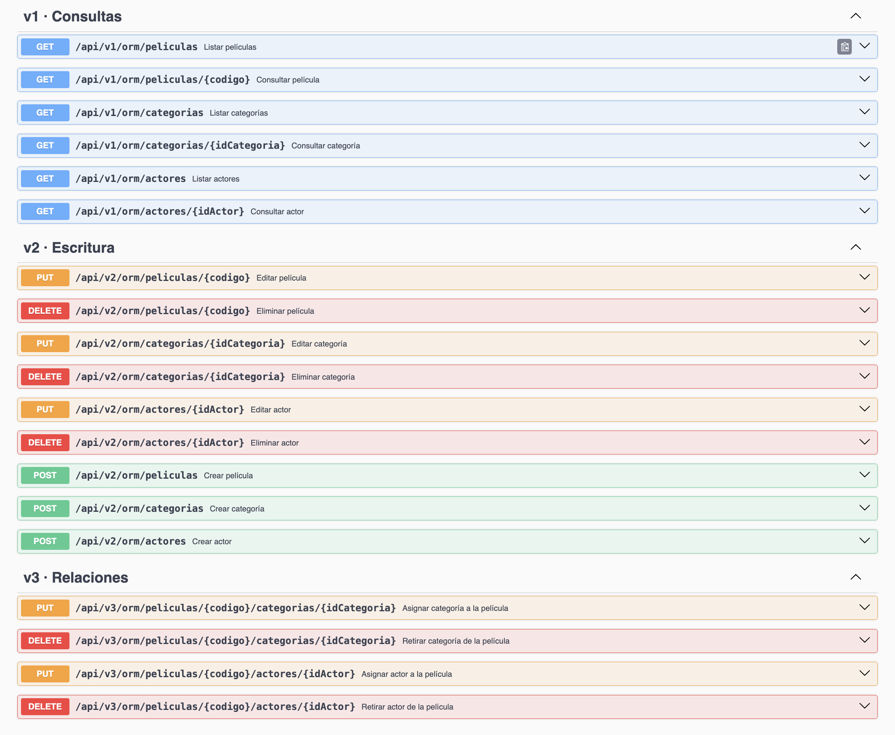

# Catálogo de películas · Práctica de aula

SQLite ya sabe quién participa en cada película. ¿Qué datos llegan hoy a la API y qué tendrás que añadir para mostrar el reparto? Guarda la primera respuesta de Swagger para compararla con la del final de la sesión.

## Arranque

Necesitas un JDK 21 y Maven 3.6.3 o posterior. Descomprime el proyecto y abre una terminal en la carpeta que contiene `pom.xml` y `data/`. La conexión utiliza una ruta relativa. La base `data/peliculas.sqlite3` ya contiene los datos de la actividad.

```bash
mvn clean spring-boot:run
```

Abre [Swagger UI](http://localhost:8080/swagger-ui.html), despliega **Películas**, elige **Consultar película** y prueba con `PEL001`. También puedes consultar el [contrato OpenAPI](http://localhost:8080/v3/api-docs) o ejecutar:

```bash
curl http://localhost:8080/api/orm/peliculas/PEL001
```

## Modelo entidad-relación de SQLite



**Cómo leerlo.** Una película puede tener de cero a muchos actores y un actor puede participar en varias películas. Cada fila de `pelicula_actor` enlaza exactamente una película con un actor. La pareja de claves forma su clave primaria, de modo que el mismo actor aparece una sola vez en el reparto de cada película. La relación con categorías sigue la misma regla. Las claves foráneas usan borrado en cascada para limpiar las filas de vínculo. El esquema reproducible está en `data/inicial.sql`. Los documentos de los actores son ficticios.

## Consultas disponibles

| Recurso | Listar | Obtener un elemento |
|---|---|---|
| Películas | GET /api/orm/peliculas | GET /api/orm/peliculas/{codigo} |
| Actores | GET /api/orm/actores | GET /api/orm/actores/{idActor} |
| Categorías | GET /api/orm/categorias | GET /api/orm/categorias/{idCategoria} |

Ejemplos de claves existentes: `PEL001`, `PAS000001` y `1`. Un código de película válido que no existe, como `PEL999`, produce una respuesta HTTP 404.

## Punto de partida · Una película con dos listas vacías

Consulta `GET /api/orm/peliculas/PEL001`. Guarda el resultado:

```json
{"codigo":"PEL001","titulo":"El viaje de Chihiro","anioEstreno":2001,"duracionMinutos":125,"categorias":[],"reparto":[]}
```

Sigue el título en el código: la columna `titulo_texto` se lee en `PeliculaEntity.tituloFila`, pasa a `Pelicula.nombre` mediante `PeliculaMapper.toDomain` y llega a `PeliculaResponse.titulo` mediante `toApi`. La entidad de película contiene sus cuatro atributos propios. En el dominio ya existen las colecciones de actores y categorías. El método toDomain las inicializa con List.of(); toApi ya transforma sus elementos en nombres. Las listas vacías indican el estado inicial del ejercicio.

### Al empezar · Descubre la relación en SQLite

Abre la base incluida y ejecuta estas dos consultas:

```sql
SELECT pelicula_codigo, id_actor
FROM pelicula_actor
WHERE pelicula_codigo = 'PEL001';

SELECT a.nombre
FROM pelicula_actor pa JOIN actores a ON a.id_actor = pa.id_actor
WHERE pa.pelicula_codigo = 'PEL001'
ORDER BY a.nombre;
```

¿Qué añade la segunda consulta? Localiza en el diagrama las dos claves que permiten obtener «Alba Vega» a partir de PEL001. Repite el recorrido para las categorías. Compara lo que sabes ahora con las dos listas vacías de la respuesta inicial.

## Trabajo de la sesión

**Primera hora.** Tras la observación inicial, mueve las consultas a `/api/v1/orm/*` y actualiza las rutas de las pruebas. Implementa en `/api/v2/orm/*` el alta, la edición y el borrado de películas, actores y categorías. Dispones de los DTO de entrada y los tipos Datos. Comprueba que puedes crear un recurso y recuperarlo por su identificador.

**Segunda hora.** Usa el diagrama para incorporar las dos asociaciones en `PeliculaEntity`. Identifica para cada colección la tabla intermedia, la columna que apunta a la película y la que apunta al otro recurso. En `PeliculaMapper.toDomain`, sustituye las dos listas vacías por los actores y categorías de la entidad, convirtiendo sus elementos con ActorMapper.toDomain y CategoriaMapper.toDomain dentro de la transacción. El dominio, el DTO y toApi ya están preparados. Implementa en `/api/v3/orm/*` las operaciones de asignación y retirada.

**Comprobación final.** Antes de modificar los vínculos iniciales, vuelve a consultar PEL001: ahora deberías poder leer «Alba Vega» y «Leo Sol» en su reparto, y «Animación» y «Fantasía» en sus categorías. Actualiza la prueba del contrato inicial para comprobar esos campos. Usa después PEL002, que parte con reparto vacío: asígnale un actor dos veces, comprueba que aparece una sola vez y retíralo. Explica qué parte ha resuelto la relación JPA y qué parte ha decidido el mapper de la API.


