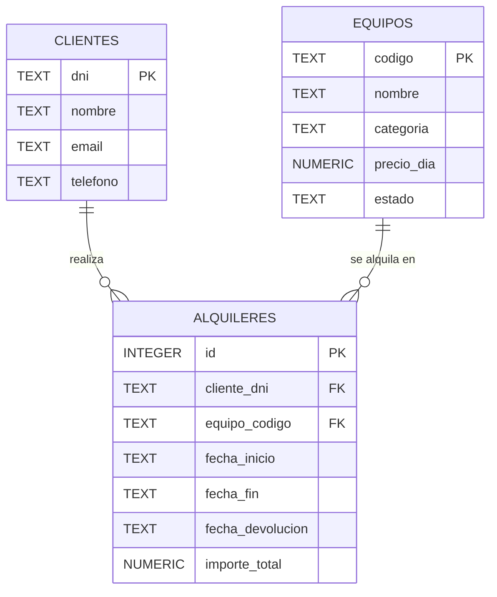

# SportRent — Examen práctico de Acceso a Datos (120 minutos)

**Java 17 · Maven · JPA/Hibernate · SQLite · JPQL obligatorio · 3 DAO**

## Objetivo y normas

Implementar SOLO `ClienteDao`, `EquipoDao` y `AlquilerDao`, sin modificar firmas, entidades, DTO, modelos, mappers, persistencia ni tests.
Las clases persistentes se llaman `ClienteEntity`, `EquipoEntity`, `AlquilerEntity`; las clases de modelo se llaman `Cliente`, `Equipo`, `Alquiler`.
Los tres DAO son independientes: ninguno puede invocar otro DAO. Los métodos públicos **nunca propagan excepciones de aplicación o persistencia**. Está prohibido mostrar mensajes por consola desde los DAO.

Las consultas usan **JPQL obligatorio**, con `EntityManager.createQuery(...)` y parámetros enlazados; no se permite SQL nativo, JDBC en los DAO ni calcular agrupaciones con Java Streams. Las listas son siempre **no nulas**; cuando no haya resultados, devolver una lista vacía.

## Entidades y claves

| Tabla | Entidad JPA | Modelo | Clave primaria |
|---|---|---|---|
| `clientes` | `ClienteEntity` | `Cliente` | `String dni`, manual |
| `equipos` | `EquipoEntity` | `Equipo` | `String codigo`, manual |
| `alquileres` | `AlquilerEntity` | `Alquiler` | `Long id`, autogenerado |

`AlquilerEntity` tiene relaciones `@ManyToOne` con cliente y equipo y un campo `importeTotal` persistido. En cada inserción o actualización correcta de alquiler debe calcularse **(días naturales entre las fechas de texto ISO (inicio y fin incluidos)) × precioDia del equipo**. Esto conserva el importe histórico aunque después cambie la tarifa.

### Contratos de error (obligatorios)

- `listarTodos` y las nueve consultas: devolver `List.of()` o equivalente cuando no haya coincidencias o se produzca una excepción controlable; **nunca null**.
- `buscarPorId`: devolver `null` cuando el ID sea nulo, vacío (si String) o no exista.
- `insertar`, `actualizar`, `eliminar`: devolver `false` ante datos inválidos, duplicados, IDs inexistentes, errores de integridad o fallos de persistencia. Devolver `true` solo después de confirmar cambios.
- Escribir dentro de una transacción y ejecutar `rollback` si hay errores. Se prohíbe dejar cambios parciales.
- Clientes y equipos con alquileres asociados **no se eliminan**. Un alquiler no puede referenciar clientes/equipos inexistentes.
- No se permite crear un alquiler cuyo intervalo se solape (incluidos extremos) con otro **no devuelto** del mismo equipo. Dos intervalos `[inicio, fin]` se solapan cuando `inicio1 <= fin2 && fin1 >= inicio2`.
- La actualización no cambia la clave primaria; la de alquiler sí puede modificar fechas, cliente y equipo sin infringir las reglas.
- `estado` es texto de referencia, no reemplaza el control de disponibilidad por fechas.
- Listar siempre ordenado por el identificador ascendente. Para empates de consulta, seguir el criterio de cada método.

## Diagrama entidad-relación de la base de datos

Las tres tablas y sus relaciones se muestran a continuación. Las claves de `clientes` y `equipos` son **cadenas introducidas manualmente**; la de `alquileres` se genera automáticamente. Las dos relaciones son **uno a muchos (1:N)**.

| Tabla | Campo | Tipo SQLite | Restricción / significado |
|---|---|---|---|
| `clientes` | `dni` | `TEXT` | Clave primaria, asignación manual, obligatorio |
| `clientes` | `nombre` | `TEXT` | Obligatorio |
| `clientes` | `email` | `TEXT` | Obligatorio |
| `clientes` | `telefono` | `TEXT` | Obligatorio |
| `equipos` | `codigo` | `TEXT` | Clave primaria, asignación manual, obligatorio |
| `equipos` | `nombre` | `TEXT` | Obligatorio |
| `equipos` | `categoria` | `TEXT` | Obligatorio |
| `equipos` | `precio_dia` | `NUMERIC` | Obligatorio |
| `equipos` | `estado` | `TEXT` | Obligatorio |
| `alquileres` | `id` | `INTEGER` | Clave primaria autogenerada |
| `alquileres` | `cliente_dni` | `TEXT` | Clave foránea hacia `clientes(dni)`, obligatorio |
| `alquileres` | `equipo_codigo` | `TEXT` | Clave foránea hacia `equipos(codigo)`, obligatorio |
| `alquileres` | `fecha_inicio` | `TEXT` | Fecha como texto `AAAA-MM-DD`, obligatoria |
| `alquileres` | `fecha_fin` | `TEXT` | Fecha como texto `AAAA-MM-DD`, obligatoria |
| `alquileres` | `fecha_devolucion` | `TEXT` | Fecha como texto `AAAA-MM-DD`, opcional (`NULL` = no devuelto) |
| `alquileres` | `importe_total` | `NUMERIC` | Importe histórico calculado al insertar o actualizar |

**Tipos en Java:** `AlquilerEntity` y `Alquiler` declaran `fechaInicio`, `fechaFin` y `fechaDevolucion` como `String`. No se utiliza `@Temporal`, `Date`, `LocalDate` como atributo ni un conversor JPA de fechas. Para preservar el orden cronológico, todas las fechas deben tener exactamente el formato `AAAA-MM-DD` (por ejemplo, `"2026-11-03"`). La comparación de estas cadenas ordenadas funciona también en JPQL. El DAO resuelto puede utilizar herramientas de Java internamente para validar fechas y calcular la duración, pero la API pública trabaja solo con cadenas.

Por ejemplo, crear un alquiler se realiza con `new Alquiler(null, "78901234G", "KAY-001", "2026-11-01", "2026-11-03", null)`, **sin convertir cadenas a objetos de fecha**.

## 1. ClienteDao: firmas y resultados de ejemplo

| Método (firma completa) | Regla | Ejemplo de resultado devuelto |
|---|---|---|
| `List<Cliente> listarTodos()` | Orden por DNI | `List<Cliente>` de 7 elementos; primero `Cliente(dni="12345678A", nombre="Ana López", ...)` |
| `Cliente buscarPorId(String dni)` | Buscar clave exacta | `buscarPorId("23456789B")` → `Cliente(dni="23456789B", nombre="Luis Pérez", ...)`; `buscarPorId("X")` → `null` |
| `boolean insertar(Cliente m)` | DNI manual; no duplicados | Insertar `Cliente("99999999Z","Nueva","nueva@test.es","600000000")` → `true`; repetir DNI → `false` |
| `boolean actualizar(Cliente m)` | No cambiar DNI | Actualizar nombre de `12345678A` a `Ana Editada` → `true`; posterior búsqueda devuelve nombre nuevo |
| `boolean eliminar(String id)` | No borrar con alquileres | `eliminar("78901234G")` → `true` (sin alquileres); `eliminar("12345678A")` → `false` |

### Consultas de ClienteDao

**C1 — Consulta básica.** `List<ClienteAlquileresDto> alquileresPorCliente()`. Devuelve clientes que tienen al menos un alquiler; orden por total descendente, DNI ascendente.

| dni | nombre | total |
|---|---|---:|
| 12345678A | Ana López | 4 |
| 23456789B | Luis Pérez | 3 |
| 34567890C | Marta Díaz | 2 |
| 56789012E | Elena Suárez | 2 |
| 67890123F | Rubén Martín | 2 |
| 45678901D | Pedro Ruiz | 1 |

**C2 — Consulta intermedia.** `List<ClienteAlquileresDto> clientesConMasDeDosAlquileres()`. Mantiene el mismo orden que C1.

| dni | nombre | total |
|---|---|---:|
| 12345678A | Ana López | 4 |
| 23456789B | Luis Pérez | 3 |

**C3 — Consulta avanzada.** `List<ClienteAlquileresDto> clientesSuperanReferencia(String dniReferencia)`. Devuelve los clientes cuyo número de alquileres es estrictamente superior al número de alquileres del cliente de referencia (incluidos clientes con cero alquileres en el universo de comparación). Referencia inexistente o nula → lista vacía.

Ejemplo `clientesSuperanReferencia("34567890C")` (Marta tiene 2):

| dni | nombre | total |
|---|---|---:|
| 12345678A | Ana López | 4 |
| 23456789B | Luis Pérez | 3 |

> El resultado debe obtenerse mediante una consulta JPQL. El parámetro identifica a un cliente existente que sirve de referencia para la comparación.

## 2. EquipoDao: firmas y resultados de ejemplo

| Método | Regla | Ejemplo de resultado devuelto |
|---|---|---|
| `List<Equipo> listarTodos()` | Código ascendente | Lista de 9 elementos; primer código `BICI-001` |
| `Equipo buscarPorId(String codigo)` | Código exacto | `buscarPorId("SKI-002")` → `Equipo(nombre="Esquís profesionales", precioDia=42.00, ...)` |
| `boolean insertar(Equipo m)` | Código manual | `insertar(new Equipo("NEW-999","Nuevo","Fitness",19.00,"DISPONIBLE"))` → `true`; duplicado → `false` |
| `boolean actualizar(Equipo m)` | No cambiar código | Cambiar precio de `BICI-001` a `16.00` → `true`; posterior búsqueda devuelve `16.00` |
| `boolean eliminar(String id)` | Proteger relaciones | `eliminar("KAY-001")` → `true`; `eliminar("BICI-001")` → `false` |

### Consultas de EquipoDao

**E1 — Consulta básica.** `List<Equipo> cincoMasCaros()`; ordenar precio descendente, código ascendente.

| codigo | nombre | categoria | precioDia |
|---|---|---|---:|
| SKI-002 | Esquís profesionales | Esquí | 42.00 |
| BICI-002 | Bicicleta eléctrica | Ciclismo | 35.00 |
| SKI-003 | Botas esquí | Esquí | 30.00 |
| SURF-002 | Tabla profesional | Surf | 30.00 |
| BICI-003 | Bicicleta montaña | Ciclismo | 25.00 |

**E2 — Consulta intermedia.** `List<PrecioCategoriaDto> maximoPrecioPorCategoria()`. Precio máximo por categoría solo de categorías con al menos dos equipos, orden alfabético de categoría.

| categoria | precioMaximo |
|---|---:|
| Ciclismo | 35.00 |
| Esquí | 42.00 |
| Surf | 30.00 |

**E3 — Consulta avanzada.** `List<EquipoPrecioDto> equiposSobreMediaCategoria()`. Equipo con precio superior al precio medio de su categoría; devolver también la media calculada; orden por categoría, código.

| codigo | nombre | categoria | precioDia | mediaCategoria |
|---|---|---|---:|---:|
| BICI-002 | Bicicleta eléctrica | Ciclismo | 35.00 | 25.00 |
| SKI-002 | Esquís profesionales | Esquí | 42.00 | 30.00 |
| SURF-002 | Tabla profesional | Surf | 30.00 | 21.00 |

## 3. AlquilerDao: firmas y resultados de ejemplo

| Método | Regla | Ejemplo de resultado devuelto |
|---|---|---|
| `List<Alquiler> listarTodos()` | ID ascendente | Lista de 14 elementos; primero `Alquiler(id=1, clienteDni="12345678A", equipoCodigo="BICI-001", ...)` |
| `Alquiler buscarPorId(Long id)` | Buscar ID | `buscarPorId(1L)` → `Alquiler(id=1, equipoCodigo="BICI-001", ...)`; `buscarPorId(99999L)` → `null` |
| `boolean insertar(Alquiler m)` | Validar cadenas de fecha ISO y referencias; ID generado | Crear alquiler de `KAY-001` para `78901234G` entre `2026-11-01` y `2026-11-03` → `true`; importe histórico `60.00` |
| `boolean actualizar(Alquiler m)` | Respetar relaciones y solapes | Cambiar el alquiler `id=8` a fechas `2026-11-01` y `2026-11-02` → `true` y se recalcula el importe |
| `boolean eliminar(Long id)` | Borrado persistente | `eliminar(8L)` → `true`; posterior `buscarPorId(8L)` → `null` |

### Consultas de AlquilerDao

**A1 — Consulta básica.** `List<Alquiler> pendientesDevolucion()`. Solo `fechaDevolucion IS NULL`, orden por fecha de fin ascendente e ID como desempate.

| id | clienteDni | equipoCodigo | fechaFin |
|---:|---|---|---|
| 10 | 45678901D | SKI-003 | 2026-09-07 |
| 3 | 12345678A | SKI-002 | 2026-09-12 |
| 7 | 23456789B | SURF-001 | 2026-09-13 |
| 12 | 56789012E | SURF-002 | 2026-09-19 |
| 14 | 67890123F | BICI-003 | 2026-09-27 |

> La tabla anterior debe leerse **ordenada por fechaFin**: la secuencia esperada de ID es **10, 3, 7, 12, 14**.

**A2 — Consulta intermedia.** `List<EquipoAlquileresDto> equiposAlquiladosDosVeces()`; mínimo dos alquileres; total descendente, código ascendente.

| codigo | nombre | total |
|---|---|---:|
| BICI-002 | Bicicleta eléctrica | 3 |
| BICI-001 | Bicicleta urbana | 2 |
| BICI-003 | Bicicleta montaña | 2 |
| SKI-002 | Esquís profesionales | 2 |
| SURF-002 | Tabla profesional | 2 |

**A3 — Consulta intermedia.** `List<EquipoIngresosDto> tresEquiposMasIngresos()`. Sumar `importeTotal` histórico; ingresos descendentes y código ascendente.

| codigo | nombre | total | ingresos |
|---|---|---:|---:|
| BICI-002 | Bicicleta eléctrica | 3 | 280.00 |
| SKI-002 | Esquís profesionales | 2 | 252.00 |
| BICI-003 | Bicicleta montaña | 2 | 125.00 |

## 4. Pruebas y calificación

Las pruebas **no se basan en mensajes por consola ni en `toString()`**: verifican valores retornados, persistencia real, estado tras errores, aislamiento, tipos de objetos y cumplimiento de los requisitos de implementación JPQL.

Las 120 pruebas JUnit están ordenadas por `@Order`. Cada una utiliza una copia nueva de SQLite: **ningún test depende de un test anterior**.

| Bloque | Pruebas | Máximo |
|---|---:|---:|
| ClienteDao CRUD y defensiva | 20 | 1.40 |
| EquipoDao CRUD y defensiva | 20 | 1.40 |
| AlquilerDao CRUD y defensiva | 25 | 1.70 |
| Consultas básicas | 12 | 0.75 |
| Consultas intermedias | 20 | 1.25 |
| Consultas avanzadas | 23 | 1.50 |
| **TOTAL funcionalidad** | **120** | **8.00** |
| Checkstyle, PMD, CPD | — | 1.00 |
| Javadoc de DAO y métodos | — | 1.00 |

El punto Javadoc solo se aplica si se alcanzan **6.40 puntos de los 8 de funcionalidad**. No hay puntos independientes por programación defensiva: sus comprobaciones están integradas en las pruebas de cada DAO.

**Comandos:** `mvn test` para los tests y `mvn clean verify -Pnota` para el informe completo en `target/nota/informe-nota.md`.

## Nota sobre sintaxis JPQL

En JPQL se utilizan los nombres de las entidades y sus atributos Java, no los nombres físicos de las tablas SQLite. El proyecto proporciona la configuración de Hibernate necesaria para ejecutar las consultas. Las pruebas evalúan resultados y requisitos técnicos sin imponer una cadena de consulta idéntica a la de referencia.

## Correspondencia entre enunciado y API Java

Los nombres, parámetros y tipos de retorno de las tablas anteriores son **las firmas exactas** que se deben implementar. Los tests JUnit invocan esa API directamente; no se debe cambiar ningún nombre ni sustituir los modelos y DTO por entidades de persistencia. Cada método que devuelve una lista debe entregar una lista vacía (nunca `null`) cuando no hay resultados. Los ejemplos representan **objetos devueltos**, no mensajes de consola.

## Modelos Java (clases POJO, no records)

Todas las clases del paquete `model` son **clases Java normales**, incluidos los resultados de consultas: `ClienteAlquileres`, `EquipoAlquileres`, `EquipoIngresos`, `EquipoPrecio` y `PrecioCategoria`. Disponen de constructor vacío, constructor con campos, getters y setters. Ejemplo: `resultado.getDni()`, `resultado.getTotal()` y `resultado.getPrecioMaximo()`. No se utilizará sintaxis propia de `record` como `resultado.dni()` o `resultado.total()`.

**Calificación inicial:** los tres DAO suministrados contienen métodos pendientes de implementar. Sin resolver ninguno, la nota funcional será 0 y no se otorgarán puntos de calidad ni documentación: **0,00/10**. El corrector no contará los informes existentes en `target/` porque esa carpeta no se distribuye. Para evaluar, ejecutar `mvn clean verify -Pnota`.

